# Interaction 3D : techniques de manipulation

**Pacôme CAILLETEAU**
FIL A3 Front - IMT Atlantique
Cours RX - Réalité virtuelle et interactions 3D
5 novembre 2026

Dépôt : [github.com/PacomeCailleteau/interaction-3d](https://github.com/PacomeCailleteau/interaction-3d)

# 1. Prise en main et référence initiale

J’ai utilisé un Meta Quest 2 avec les contrôleurs Touch. Le projet fourni a été ouvert avec Unity 6000.3.27f1, en conservant XRI 3.3.0, OpenXR 1.16.0 et Input System 1.17.0. La scène Interaction est construite pour Android avec OpenXR et le rendu Multi Pass.

| Essai de deux minutes | Étages complets |
| --- | --- |
| Premier essai | 3 |
| Deuxième essai et meilleur score | 4 |

Je préfère le déplacement continu au joystick pour cette tâche. Il permet d’ajuster progressivement ma position près des générateurs et de la tour. La téléportation m’a paru plus rapide, mais je la trouvais déstabilisante. À l’arrivée, je perdais mes repères et je devais me réorienter.

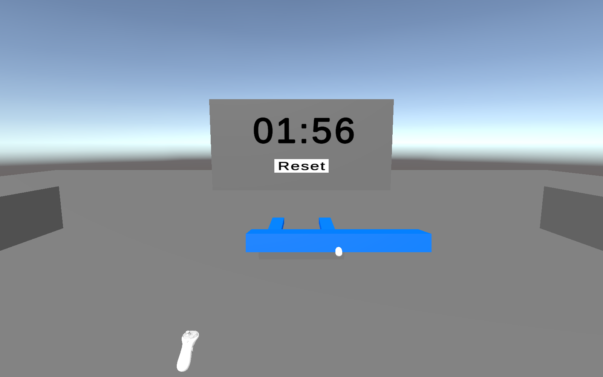

Les vues de manipulation proviennent de la caméra du joueur dans Unity, avec des contrôleurs simulés. Les ressentis viennent des essais dans le casque.

# 2. Changer de technique sur chaque main

Controller Manager est présent sur les deux contrôleurs. Chaque technique est un enfant direct du contrôleur et porte le tag ControllerMode. B change le mode droit et Y le mode gauche. Le script désactive les autres modes avant d’activer le suivant.

J’ai d’abord vérifié ce mécanisme avec des modes temporaires et des entrées simulées. Un seul mode reste actif par main. B et Y sont indépendants, le cycle revient au premier mode après le dernier et garder le bouton enfoncé ne provoque pas de changements répétés. Les modes temporaires ont ensuite été retirés.

Étape intermédiaire : modes temporaires dans la hiérarchie et référence Switch Mode du contrôleur droit.

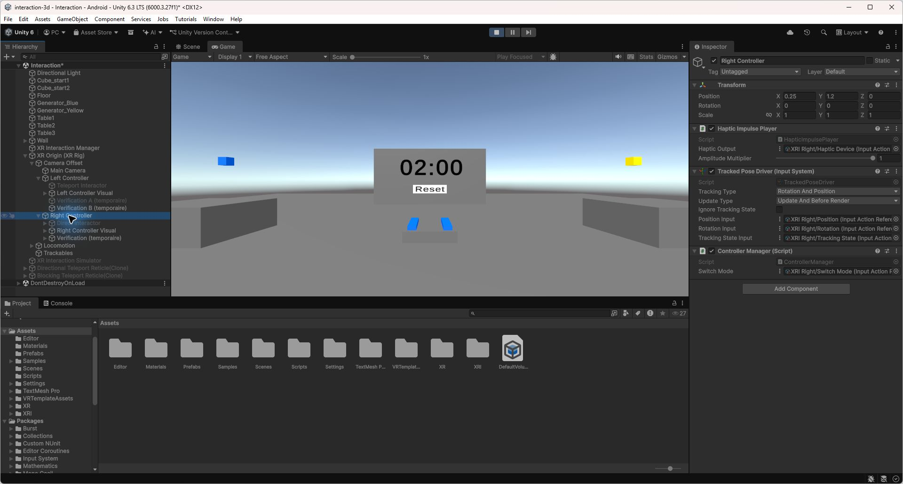

Dans la version finale, chaque contrôleur dispose de six modes. Les entrées de la main gauche ont été remappées vers les actions XRI Left et leur latéralité est réglée à gauche.

| Ordre | Mode |
| --- | --- |
| 1 | Saisie directe |
| 2 | Rayon fixe bleu |
| 3 | Rayon réglable vert |
| 4 | Rayon orange avec Force Grab |
| 5 | Near Far violet, à distance |
| 6 | Near Far jaune, rappel à la main |

Configuration finale : six modes sous chaque contrôleur, dans le même ordre.

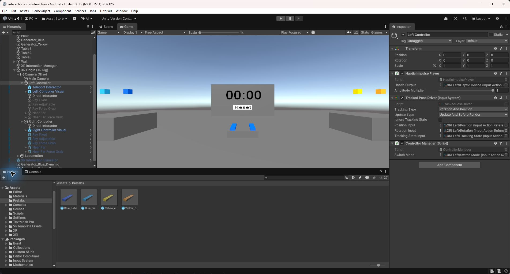

Les rayons excluent la couche Teleport et l’interaction UI est désactivée. Le masque physique du raycast et les couches d’interaction XRI sont deux filtres différents. Les blocs doivent être autorisés par les deux.

Difficulté rencontrée : le joystick peut manipuler un bloc et piloter la locomotion en même temps. Les commandes concurrentes sont suspendues pendant la manipulation, puis restaurées après le dernier relâchement concerné.

# 3. Saisir au point de contact

J’ai dupliqué les deux générateurs et les deux prefabs pour garder la saisie d’origine disponible. Les copies sont bleu clair et jaune orangé. Chaque nouveau générateur référence son prefab et le même chronomètre.

Sur les copies, Use Dynamic Attach calcule l’attache lors de la prise. Match Position utilise le point de contact, Match Rotation conserve l’orientation au moment de la prise et Snap To Collider Volume limite l’attache au volume du bloc. Les options sont activées dans la configuration retenue.

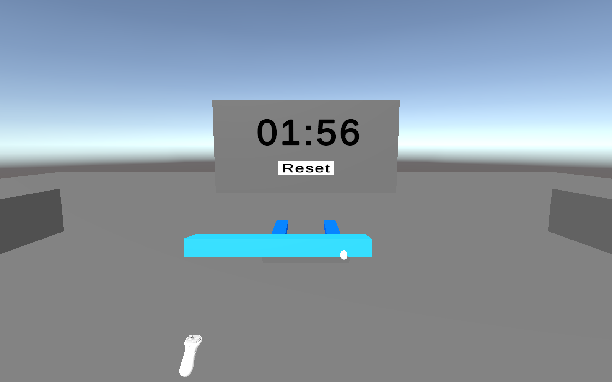

Je préfère la saisie au point de contact, car le bloc reste tenu à l’endroit où je l’attrape. En le prenant par une extrémité, je peux le positionner sans devoir autant avancer les bras.

Cette différence est surtout utile pour replacer un bloc sous ceux qui sont déjà empilés. Avec la saisie d’origine, le bloc se recentre brusquement dans la main. Ce déplacement peut heurter les blocs voisins et faire tomber une partie de la tour. La saisie au point de contact permet de le reprendre sans ce décalage.

Le choix de la prise reste important. Tourner le contrôleur fait pivoter le bloc autour du point choisi. Une prise à l’extrémité donne de la portée, mais l’autre bout du bloc décrit un mouvement plus large. Il faut en tenir compte près des blocs déjà posés.

Les vérifications dans Unity confirment le suivi du point saisi sur les deux couleurs, la conservation de l’orientation initiale, le relâchement et le fonctionnement des quatre générateurs avec Reset.

# 4. Comparer les rayons virtuels

Les trois rayons utilisent la gâchette sous l’index et les mêmes filtres. Le rayon permet d’atteindre les générateurs sans s’approcher. La saisie directe reste plus simple pour placer un bloc proche, car son mouvement suit directement celui de la main.

| Variante | Force Grab | Attache au joystick |
| --- | --- | --- |
| Bleu | Non | Non |
| Vert | Non | Distance et rotation |
| Orange | Oui | Distance et rotation |

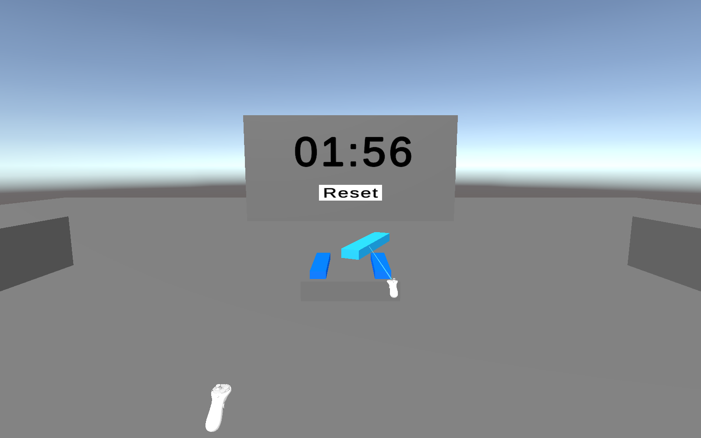

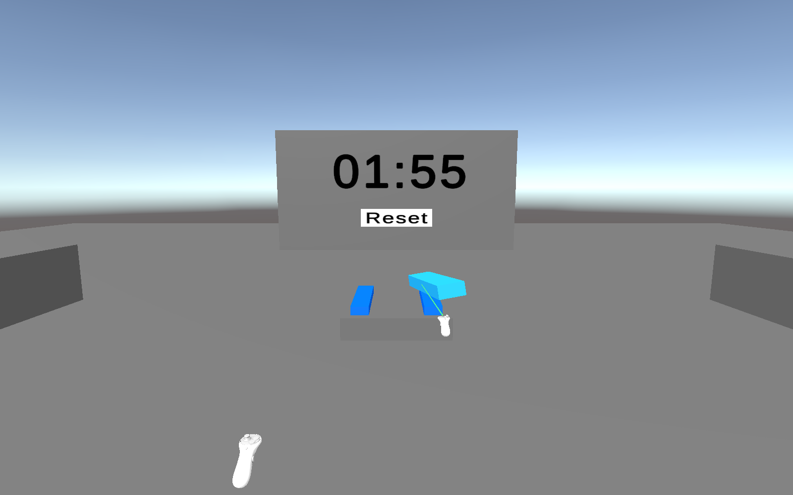

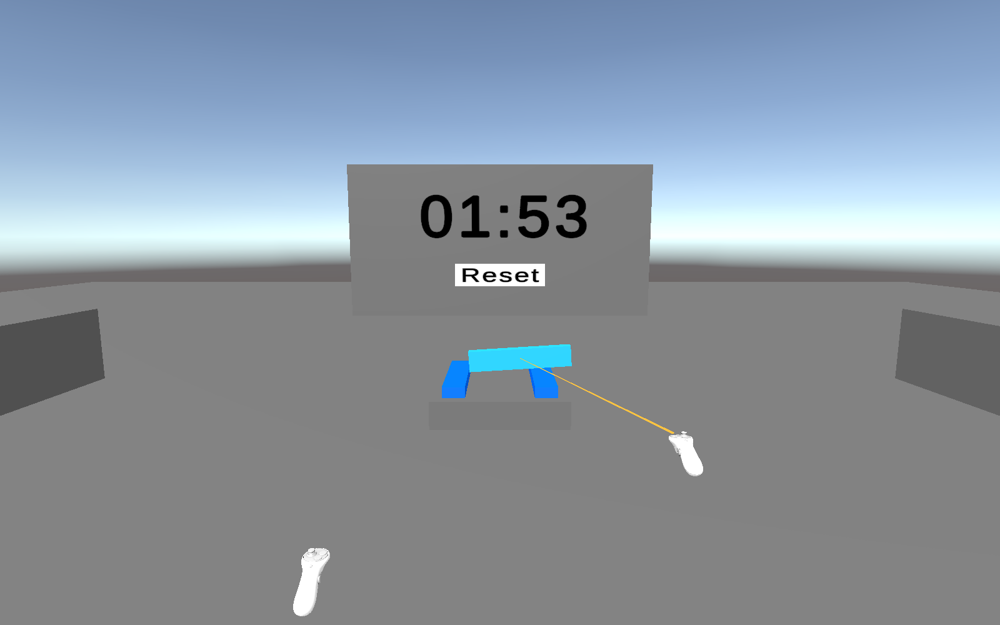

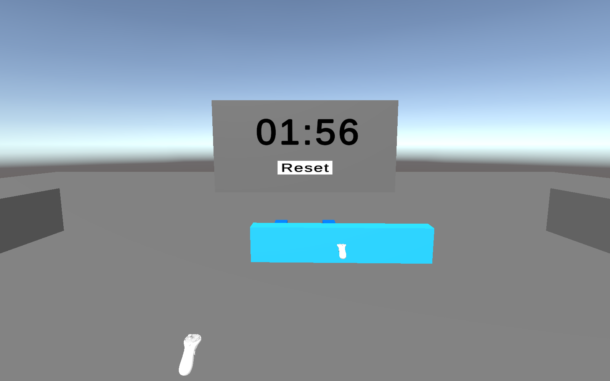

Je préfère le rayon orange. Le bloc vient directement à la main, puis je peux l’éloigner légèrement au joystick pour le placer. Le vert arrive en deuxième position. Le réglage est pratique, mais ramener un bloc saisi de loin prend du temps. Le bleu est le moins pratique. Sans réglage de distance, un bloc pris trop loin est difficile à placer sans se déplacer.

Force Grab réduit le transport à distance, mais change brusquement la position du bloc lors de la prise. Manipulate Attach Transform permet d’ajuster ensuite la distance et la rotation. Le meilleur score illustratif retenu pour l’orange est de 7 étages. Les valeurs simulées sont regroupées dans le bilan.

# 5. Near Far : proche et lointain

J’ai ajouté deux modes Near Far à partir du prefab fourni. Ils permettent une saisie au contact et une sélection à distance. Far Attach Mode = Far conserve le bloc à distance dans le mode violet. Far Attach Mode = Near le ramène à la main dans le mode jaune.

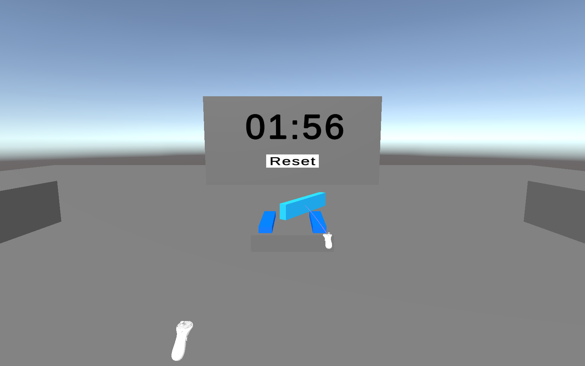

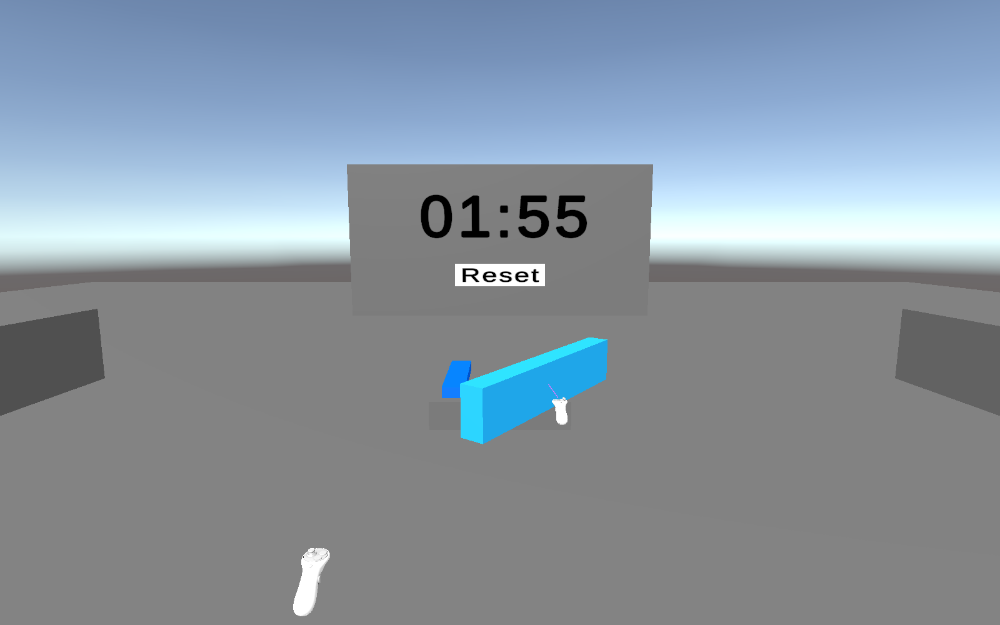

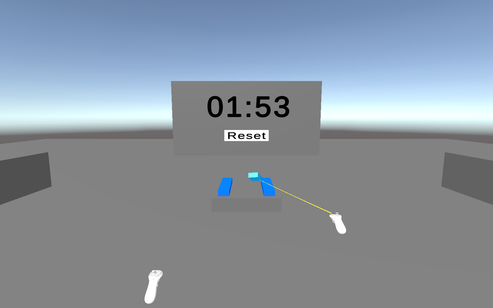

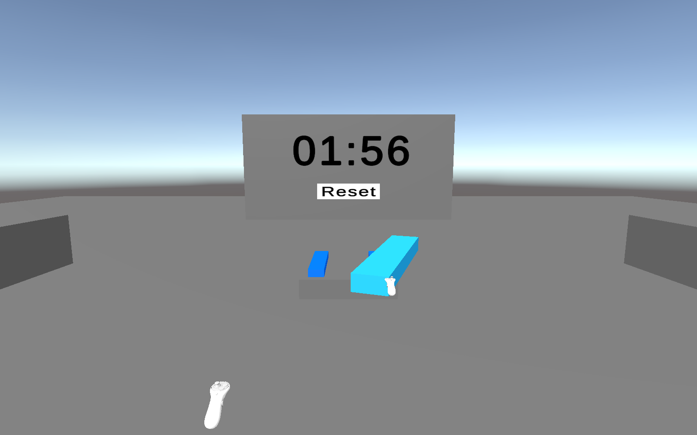

Ma préférence dépend de ma position par rapport à la tour. Lorsque je suis loin, je préfère le violet. Je peux rapprocher, éloigner et orienter rapidement le bloc au joystick. Lorsque je suis juste devant la tour, je préfère le jaune. Je peux poser le bloc avec les mouvements du contrôleur, sans avoir besoin de réglages à distance.

Le changement de commande est sensible entre les variantes. Avec le jaune, une fois le bloc dans la main, je ne peux plus le déplacer ou le tourner à distance au joystick. C’est pratique près de la tour, mais plus contraignant quand je veux encore travailler de loin.

Je rapproche cette technique du principe hybride de HOMER présenté dans le cours : sélectionner avec un rayon, puis manipuler avec une commande liée à la main virtuelle. Near Far combine en plus une saisie proche et une saisie lointaine. Near ou Far détermine ici où reste l’objet après sa sélection.

Rapprochement avec le cours Interaction 3D, partie Manipulation, diapositives HOMER : [etiennepeillard.com/fr/slides/vr-interaction/](https://www.etiennepeillard.com/fr/slides/vr-interaction/).

# 6. Manipuler avec les deux mains

Les six techniques ont été ajoutées au contrôleur gauche en adaptant les actions et la latéralité. Les deux mains peuvent tenir deux blocs distincts en même temps. Chaque bloc reste tenu par une seule main à la fois.

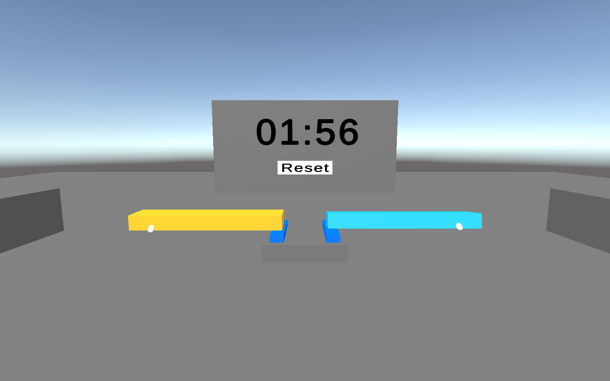

J’ai testé la manipulation avec les deux mains en étant près de la tour. Les deux contrôleurs fonctionnent simultanément, mais dans cette situation, je préfère utiliser uniquement la main droite.

Étant droitier, je trouve Near Far avec Force Grab, représenté en jaune, plus pratique à droite pour poser les blocs délicatement et précisément. Je préfère laisser la main gauche sans manipulation pour me concentrer sur le bloc que je place.

Près de la tour, utiliser deux mains ne m’a donc pas paru plus efficace. Je suis plus à l’aise en gardant une seule main pour manipuler les blocs.

Dans Unity, j’ai aussi vérifié une saisie symétrique et deux combinaisons complémentaires : Near Far jaune à gauche avec violet à droite, puis l’inverse. Ces vérifications montrent que les deux techniques peuvent fonctionner ensemble. Elles ne remplacent pas mon choix personnel près de la tour.

Un verrou partagé évite qu’une main réactive la locomotion alors que l’autre l’utilise encore pour manipuler un bloc. Les deux ordres de relâchement ont été vérifiés, ainsi que la génération des deux couleurs, Reset et le changement de navigation.

La comparaison chiffrée illustrative retient 5 puis 6 étages à deux mains, contre 6 puis 8 pour Near Far jaune à droite seule. Ces valeurs simulées décrivent le scénario comparatif, pas une mesure supplémentaire au casque.

# Bilan comparatif et état final

J’ai relevé 3 puis 4 étages lors des deux essais initiaux au Quest 2. Pour compléter la comparaison, j’ai utilisé des valeurs simulées pour les autres configurations. Elles sont signalées dans le tableau. Les préférences décrites dans les étapes viennent des essais réels.

| Configuration | Gauche / droite | Saisie | Options | Essai 1 | Meilleur | N | Nature | Observation |
| --- | --- | --- | --- | --- | --- | --- | --- | --- |
| Directe initiale | Navigation / Directe | Centre | Saisie au contact | 3 | 4 | 2 | Relevé | Repère initial |
| Directe dynamique | Navigation / Directe | Contact | Dynamic Attach | 4 | 6 | 2 | Simulé | Prise conservée |
| Rayon bleu | Navigation / Rayon fixe | Contact | Force Grab non, attache fixe | 2 | 3 | 2 | Simulé | Distance contraignante |
| Rayon vert | Navigation / Rayon réglable | Contact | Force Grab non, attache réglable | 4 | 6 | 2 | Simulé | Rappel lent de loin |
| Rayon orange | Navigation / Force Grab | Contact | Force Grab oui, attache réglable | 5 | 7 | 2 | Simulé | Préféré parmi les rayons |
| Near Far violet | Navigation / Near Far | Contact | Far Attach Mode = Far | 6 | 8 | 2 | Simulé | Préféré loin de la tour |
| Near Far jaune | Navigation / Near Far | Contact | Far Attach Mode = Near | 6 | 8 | 2 | Simulé | Préféré près de la tour |
| Deux mains | Near Far violet / Near Far jaune | Contact | Far à gauche, Near à droite | 5 | 6 | 2 | Simulé | Une main préférée près de la tour |

**Conditions.** Même tâche de tour bicolore, deux minutes par essai et Reset entre les essais. Les essais réels ont été réalisés par Pacôme CAILLETEAU sur Meta Quest 2 avec contrôleurs Touch. Les deux essais par variante et les scores des lignes simulées sont des hypothèses du tableau. La navigation continue est le choix préféré. Le mode utilisé lors de chaque essai n’a pas été relevé.

**Précision, rapidité et effort.** La saisie au point de contact évite le recentrage du bloc et réduit les mouvements de bras. Le rayon donne accès aux objets éloignés, mais son intérêt dépend du contrôle de la distance. Près de la tour, je préfère Near Far jaune à droite. Loin de la tour, le violet me paraît plus pratique. L’ordre des tests et l’apprentissage peuvent influencer les résultats. Ce tableau ne suffit pas à établir qu’une technique est toujours meilleure.

**État final.** L’application permet de changer de mode sur chaque main sans reconstruire, de créer les deux couleurs, de saisir et relâcher les blocs, de manipuler avec une ou deux mains, de naviguer et de réinitialiser la tâche. Ces fonctions ont été testées au Quest 2 et complétées par des vérifications dans Unity. Je retiens surtout l’intérêt d’adapter la technique à ma position et au placement que je veux réaliser.
