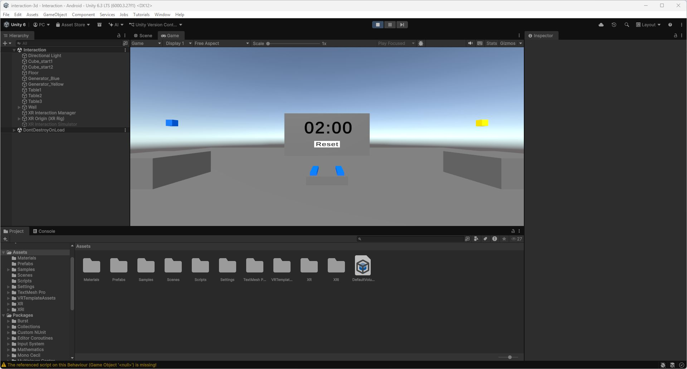

# Essais de la saisie directe initiale

Matériel : Meta Quest 2 avec contrôleurs Touch.
Personne réalisant les essais : Pacôme CAILLETEAU.
Durée : deux minutes par essai.
Nombre d’essais réalisés : deux.

## Résultats

J’ai réalisé deux essais de deux minutes avec la saisie directe initiale. J’ai construit trois étages au premier essai et quatre au deuxième. Mon meilleur score est donc de quatre étages.

| Essai | Durée | Étages complets |
| --- | --- | --- |
| 1 | 2 minutes | 3 |
| 2 | 2 minutes | 4 |

## Choix de navigation

Je préfère le déplacement continu au joystick pour cette tâche. Il permet d’ajuster progressivement ma position près des générateurs et de la tour, sans interrompre la manipulation pour choisir une destination de téléportation. Ces petits déplacements sont pratiques pour me placer avant de poser un bloc.

La téléportation m’a paru plus rapide pour changer de position, mais je l’ai trouvée déstabilisante. À l’arrivée, je perdais mes repères et je devais me réorienter par rapport à la tour. J’ai donc préféré garder le déplacement continu au joystick pour cette tâche.

Une capture du résultat de la tour et du chronomètre reste à ajouter.

## Préparation du projet

Les versions XRI 3.3.0, OpenXR 1.16.0 et Input System 1.17.0 sont conservées. Le fournisseur Android est OpenXR. Les générateurs, les points de saisie et les commandes du sujet sont inchangés.

Un défaut de Reset a été reproduit dans Unity : après expiration, un clic sur un générateur restait en attente et pouvait relancer le chronomètre après Reset. Le clic est maintenant consommé même si la création est refusée. Le même test passe après correction.

Les vérifications dans Unity confirment les deux couleurs, le démarrage au premier bloc, l’arrêt après deux minutes, la suppression des blocs par Reset et le démarrage d’un nouvel essai.

La scène au début d’un essai montre les deux générateurs, la plateforme centrale, le bouton Reset et le chronomètre à 02:00.

## Prise en main au Quest 2

J’ai pu me déplacer et orienter la caméra. En plaçant le contrôleur droit au contact d’un générateur et en appuyant sur la gâchette de l’index, je fais apparaître un bloc que je peux ensuite saisir. La manipulation initiale se fait au contact.

Les deux scores communiqués sont conservés dans le relevé des essais. La navigation utilisée pendant chacun des essais reste à préciser dans ce relevé.
