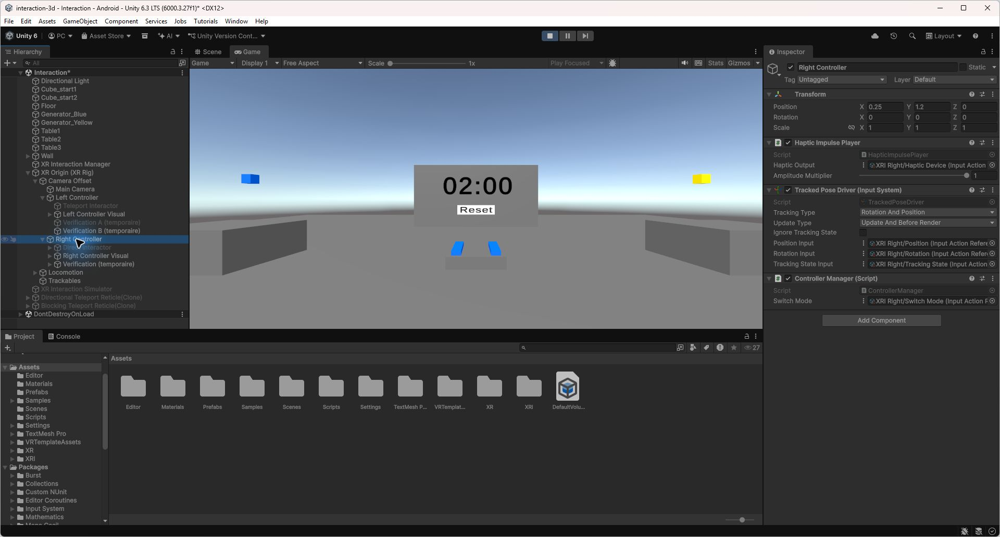
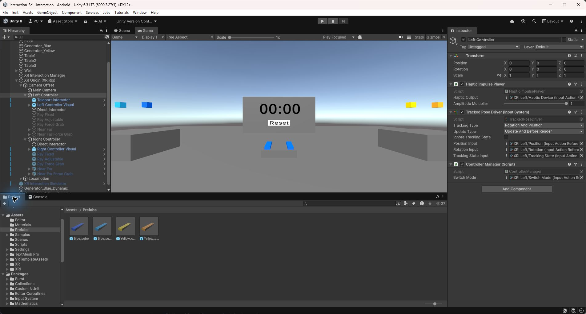

# 2. Changer de technique sur chaque main

Controller Manager est présent sur les deux contrôleurs. Chaque technique est un enfant direct du contrôleur et porte le tag ControllerMode. B change le mode droit et Y le mode gauche. Le script désactive les autres modes avant d’activer le suivant.

J’ai utilisé B et Y pour changer de technique sur chaque main. Un seul mode reste actif par contrôleur et le cycle revient au premier après le dernier. Les modes temporaires de préparation ont été retirés une fois les techniques ajoutées.

Étape intermédiaire : modes temporaires dans la hiérarchie et référence Switch Mode du contrôleur droit.

J’ai ajouté six modes sur chaque contrôleur. Pour la main gauche, j’ai remplacé les références aux actions de droite par les actions XRI Left et réglé la latéralité à gauche.

| Ordre | Mode |
| --- | --- |
| 1 | Saisie directe |
| 2 | Rayon fixe bleu |
| 3 | Rayon réglable vert |
| 4 | Rayon orange avec Force Grab |
| 5 | Near Far violet, à distance |
| 6 | Near Far jaune, rappel à la main |

Configuration finale : six modes sous chaque contrôleur, dans le même ordre.

Les rayons excluent la couche Teleport et l’interaction UI est désactivée. Le masque physique du raycast et les couches d’interaction XRI sont deux filtres différents. Les blocs doivent être autorisés par les deux.

Difficulté rencontrée : le joystick peut manipuler un bloc et piloter la locomotion en même temps. Les commandes concurrentes sont suspendues pendant la manipulation, puis restaurées après le dernier relâchement concerné.
