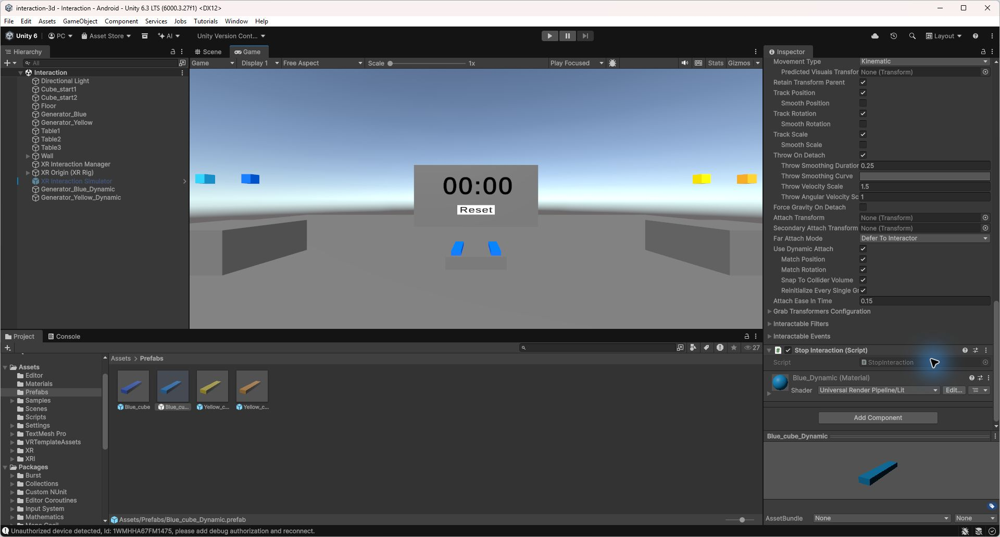

# 3. Modifier le point de saisie des blocs

J’ai dupliqué les deux générateurs et les deux prefabs de blocs pour garder la saisie d’origine disponible. Les nouvelles versions sont bleu clair et jaune orangé pour les reconnaître.

Sur les nouveaux blocs, j’ai activé Use Dynamic Attach. Match Position permet de saisir le bloc au point de contact. Match Rotation conserve son orientation au moment de la prise. Snap To Collider Volume limite le point de saisie au volume du bloc.

Les vérifications dans Unity confirment la différence entre les deux saisies. La création des blocs, le chronomètre et Reset fonctionnent avec les deux versions.

La capture ci-dessous montre les réglages du bloc bleu clair.

## Ressenti dans le casque

Je préfère la saisie au point de contact, car le bloc reste tenu à l’endroit où je l’attrape. En le prenant par une extrémité, je peux le positionner sans devoir autant avancer les bras.

Cette différence est surtout utile pour replacer un bloc sous ceux qui sont déjà empilés. Avec la saisie d’origine, le bloc se recentre brusquement dans la main. Ce déplacement peut heurter les blocs voisins et faire tomber une partie de la tour. La saisie au point de contact permet de le reprendre sans ce décalage, ce qui rend les ajustements plus pratiques.
