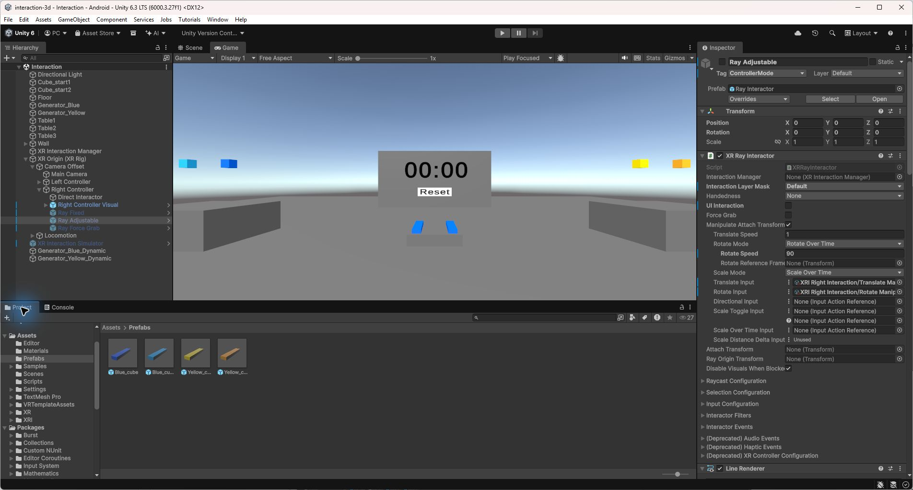

# 4. Ajouter un rayon virtuel

Je préfère le rayon orange avec Force Grab. Le bloc vient directement à la main lors de la saisie. Je peux ensuite l’éloigner légèrement avec le joystick si nécessaire pour le placer sur la tour.

Le rayon vert arrive en deuxième position. Le réglage de la distance est pratique, mais lorsqu’un bloc est saisi de loin, le ramener suffisamment près prend du temps avant de pouvoir le positionner précisément.

Le rayon bleu est celui que j’ai trouvé le moins pratique pour cette tâche. Le bloc reste à sa distance de saisie, sans possibilité de le rapprocher au joystick. S’il est pris trop loin, il devient difficile à placer sur la tour sans se déplacer.

La capture ci-dessous montre les trois rayons dans la hiérarchie et les réglages du rayon vert.

