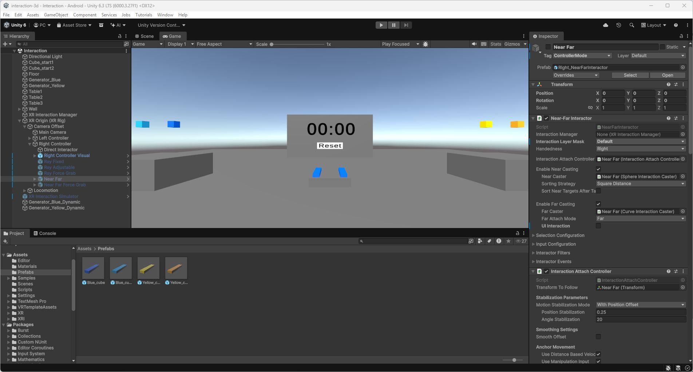

# 5. Tester Near Far

Ma préférence dépend de ma position par rapport à la tour. Lorsque je suis loin, je préfère Near Far sans Force Grab, représenté en violet. Je peux saisir un bloc à distance, puis le rapprocher, l’éloigner et l’orienter rapidement avec le joystick pour le placer.

Lorsque je suis juste devant la tour, je préfère la version jaune avec Force Grab. Le bloc vient directement à la main et je peux le poser avec les mouvements du contrôleur. Dans cette situation, les réglages à distance me sont moins utiles.

Le violet me paraît donc plus pratique pour construire à distance, tandis que le jaune convient mieux lorsque je suis proche de la tour.

La capture ci-dessous montre les deux modes dans la hiérarchie et les réglages de Near Far sans Force Grab.

