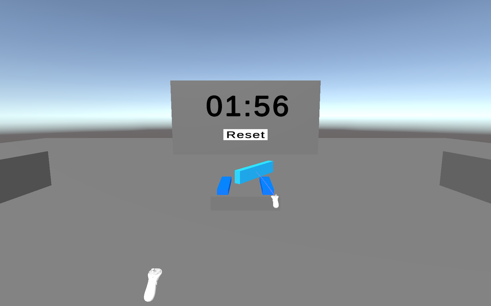
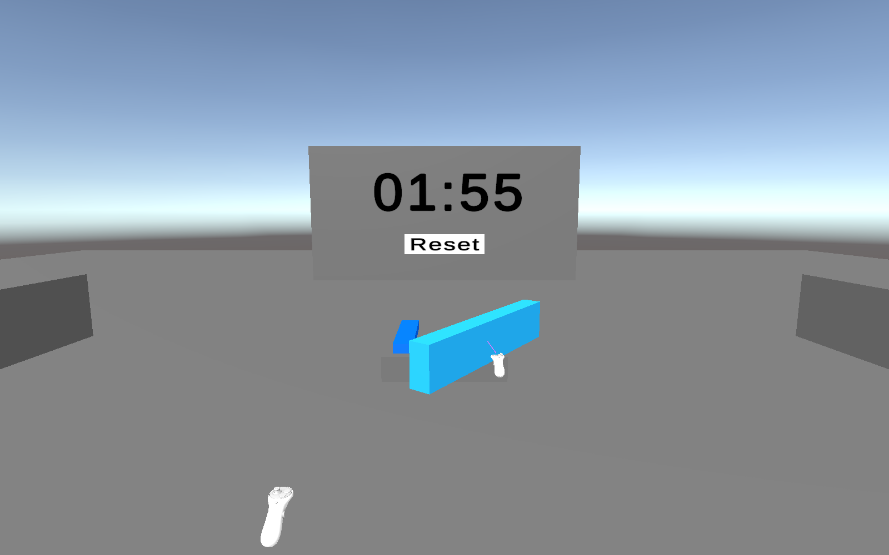
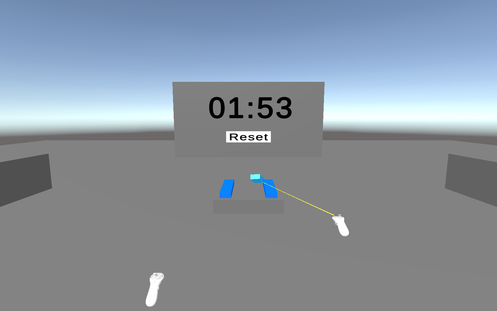
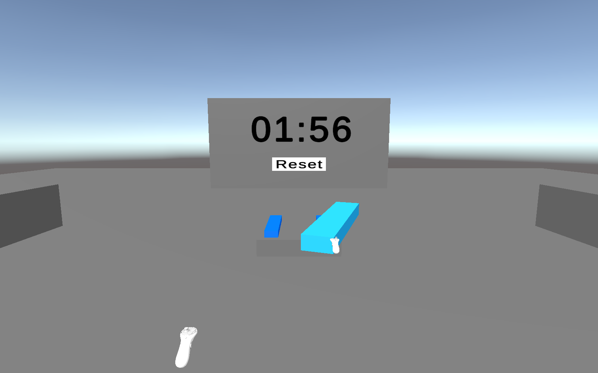

# 5. Near Far : proche et lointain

J’ai ajouté deux modes Near Far à partir du prefab fourni. Ils permettent une saisie au contact et une sélection à distance. Far Attach Mode = Far conserve le bloc à distance dans le mode violet. Far Attach Mode = Near le ramène à la main dans le mode jaune.

Ma préférence dépend de ma position par rapport à la tour. Lorsque je suis loin, je préfère le violet. Je peux rapprocher, éloigner et orienter rapidement le bloc au joystick. Lorsque je suis juste devant la tour, je préfère le jaune. Je peux poser le bloc avec les mouvements du contrôleur, sans avoir besoin de réglages à distance.

Le changement de commande est sensible entre les variantes. Avec le jaune, une fois le bloc dans la main, je ne peux plus le déplacer ou le tourner à distance au joystick. C’est pratique près de la tour, mais plus contraignant quand je veux encore travailler de loin.

Je rapproche cette technique du principe hybride de HOMER présenté dans le cours : sélectionner avec un rayon, puis manipuler avec une commande liée à la main virtuelle. Near Far combine en plus une saisie proche et une saisie lointaine. Near ou Far détermine ici où reste l’objet après sa sélection.

Rapprochement avec le cours Interaction 3D, partie Manipulation, diapositives HOMER : [etiennepeillard.com/fr/slides/vr-interaction/](https://www.etiennepeillard.com/fr/slides/vr-interaction/).
