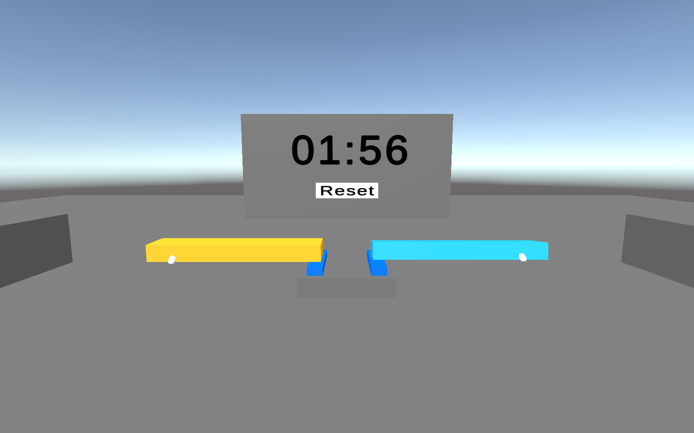

# 6. Manipuler avec les deux mains

J’ai testé la manipulation avec les deux mains en étant près de la tour. Les deux contrôleurs fonctionnent simultanément, mais dans cette situation, je préfère utiliser uniquement la main droite.

Étant droitier, je trouve Near Far avec Force Grab, représenté en jaune, plus pratique à droite pour poser les blocs délicatement et précisément. Je préfère laisser la main gauche sans manipulation pour me concentrer sur le bloc que je place.

Près de la tour, utiliser deux mains ne m’a donc pas paru plus efficace. Je suis plus à l’aise en gardant une seule main pour manipuler les blocs.

La capture ci-dessous montre les deux contrôleurs tenant chacun un bloc.

Les captures de manipulation sont réalisées dans Unity avec des contrôleurs simulés. Le chronomètre et Reset sont ceux de la scène. Le ressenti ci-dessus correspond aux essais réalisés au Quest 2.
